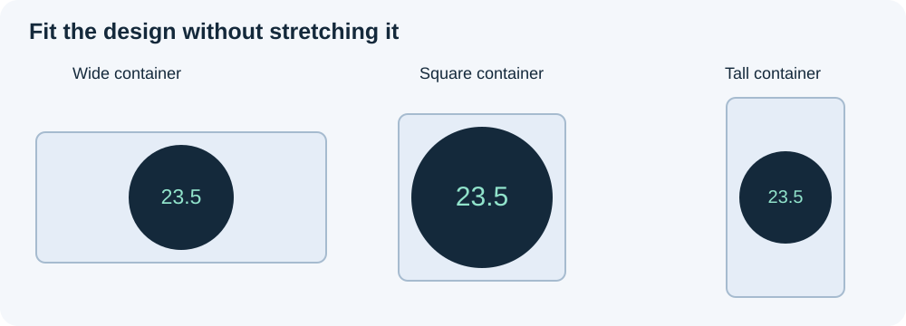

# Size and lay out an applet

Design for the **applet container**, not the phone's full screen. MATRIC makes the iframe fill that container, but does not automatically zoom your HTML to fit it or preserve your artwork's proportions.

For a complete working starting point, [copy the starter applet](starter.md). It includes the fitting code, parameters, variable display and a configurable action.

## Understand the available space

Control width and height are measured in square grid cells. A container 6 cells wide and 3 cells high is approximately **2:1**, subject to pixel rounding. Its pixel size depends on the deck grid and the space available on the device. The editor preview can have different pixel dimensions from the client.

The manifest has no preferred width, minimum size or required aspect-ratio field. Describe your recommended proportions and smallest usable size in the applet's instructions; the deck author chooses the container dimensions.

Inside the iframe, CSS viewport units and viewport media queries refer to that iframe's viewport. `100vw` means the applet width, not the whole phone width. Dimensions reported by `RESIZE` are **CSS pixels**, not physical display pixels.

## Choose how the content should fit

| Approach | Good for | Tradeoff |
| --- | --- | --- |
| Reflow with CSS Grid or Flexbox | Buttons, text, lists and interactive panels | Layout changes as the container changes shape |
| Uniform scaling with empty space | Clocks, gauges and fixed artwork | Preserves proportions, but text and touch targets shrink too |
| Internal scrolling | Mixers, lists and panels with many controls | Keeps controls readable, but some content requires scrolling |

For a round gauge, preserve its aspect ratio; stretching width and height independently makes it oval. For a panel of buttons, reflow or scrolling is usually more usable than shrinking the whole panel. The bundled world clock scales a square design uniformly; the audio mixer keeps readable client controls with internal scrolling.

MATRIC clips rendering to the container rectangle. Enlarging the applet's HTML cannot enlarge the deck control or draw over its neighbors. Decide explicitly which element scrolls; do not rely on the outer deck page to reveal overflowing content.



## How bundled applets fit

Fitting is implemented by each applet, rather than a shared MATRIC auto-zoom feature. The shipped applets use several mechanisms:

| Applets | Mechanism |
| --- | --- |
| World clock, tally counter, timekeeper, live history | A fixed design rectangle, centered and uniformly scaled with CSS `transform: translate(-50%, -50%) scale(...)` |
| Gamepad | The same uniform transform approach for an 800 × 320 design |
| Calendar | Chooses full or compact content for the available space, then uniformly scales that design |
| Gauge and compass | Sets a square content box to `min(innerWidth, innerHeight)`; the artwork fits within that square |
| VU meters | Percentage-based LED dimensions inside a full-size flex container |
| Audio mixer | Scales its design in previews; on clients, removes that transform and uses the available viewport with internal scrolling |

These mechanisms **fit within** the iframe; they do not all fill every pixel with artwork. Preserving proportions can leave unused space. The clock and gamepad fitting scripts recalculate on viewport changes and `pageshow`; their configurable padding stays outside the scaled design.

## Start with a bounded responsive layout

Include the viewport metadata and reset the browser's default body margin. Give the root a definite height before using percentage heights below it:

```html
<meta name="viewport" content="width=device-width, initial-scale=1">
<style>
  * { box-sizing: border-box; }
  html, body { width: 100%; height: 100%; margin: 0; }
  body { font: 16px system-ui, sans-serif; }
  .panel { height: 100%; padding: 8px; overflow: auto; }
  .buttons {
    display: grid;
    grid-template-columns: repeat(auto-fit, minmax(min(100%, 120px), 1fr));
    gap: 8px;
  }
  button { min-height: 44px; font: inherit; overflow-wrap: anywhere; }
</style>
<main class="panel">
  <div class="buttons">
    <button type="button">First action</button>
    <button type="button">Second action</button>
  </div>
</main>
```

The 44px minimum is a starting design choice, not a MATRIC requirement or a guaranteed physical size. Verify readability and touch accuracy on your target device. Avoid globally disabling touch gestures if part of your interface needs scrolling; restrict gesture handling to controls that need it.

For fixed artwork, an SVG can preserve proportions without a JavaScript scaling wrapper:

```html
<svg viewBox="0 0 400 400" preserveAspectRatio="xMidYMid meet"
     style="display:block;width:100%;height:100%"
     role="img" aria-label="Gauge">
  <circle cx="200" cy="200" r="180" fill="#14293b" />
</svg>
```

Place it in an element with a definite width and height. `meet` fits the whole drawing with unused space when the aspect ratios differ. For images, `object-fit: contain` offers the same fitting choice inside a sized image box; `cover` fills that box by cropping content.

## Fit a fixed design using the shipped pattern

The bundled world clock and tally counter define an explicit design size, center the design, and apply **one uniform scale**. For a 500 × 500 design, the fitting rule is:

```text
scale = min((containerWidth − 2 × padding) / 500,
            (containerHeight − 2 × padding) / 500)
```

Use your own design width and height in the two denominators. Taking the smaller ratio keeps the whole design visible. Padding belongs to the outer viewport and stays in CSS pixels; placing it inside the scaled design would scale the padding too.

This standalone layout follows that approach for ordinary HTML artwork:

```html
<style>
  html, body { width: 100%; height: 100%; margin: 0; overflow: hidden; }
  #design {
    position: absolute; left: 50%; top: 50%;
    width: 500px; height: 500px; margin: 0;
    transform-origin: center center;
  }
</style>
<div id="design">Your fixed-size artwork</div>
<script>
  const design = document.getElementById('design');
  function fit() {
    const w = document.documentElement.clientWidth;
    const h = document.documentElement.clientHeight;
    if (w <= 0 || h <= 0) return;
    const padding = Math.min(12, Math.max(0, (Math.min(w, h) - 1) / 2));
    const scale = Math.min((w - 2 * padding) / 500, (h - 2 * padding) / 500);
    design.style.transform = `translate(-50%, -50%) scale(${scale})`;
  }
  const observer = new ResizeObserver(fit);
  observer.observe(document.documentElement);
  addEventListener('pageshow', fit);
  fit();
</script>
```

Load this script after its markup. If padding or design dimensions are configurable, call `fit()` when their parameters change too. Observe the outer viewport, rather than repeatedly measuring the transformed design as the next fitting input.

This pattern scales everything, including text and hit areas. The included audio mixer takes a different approach: it fits previews, then uses the available client viewport with readable controls and internal scrolling. Treat **preview fitting** and **client usability** as separate checks; a good-looking preview alone is insufficient.

## Avoid recurring layout problems

- Give percentage-height layouts a complete height chain from `html` and `body` down to the content. Otherwise `height: 100%` may not bound the content as intended.
- Keep one owner for overall scaling. Combining a fitting wrapper with another full-design scale can shrink content twice.
- In nested Grid/Flexbox layouts, use `min-width: 0` or `min-height: 0` where a child must shrink and scroll. Otherwise its intrinsic content size can push it out of the viewport.
- Re-measure when fonts, images or dynamic lists change the layout. Viewport resize alone does not cover content changes; batch repeated measurement requests with `requestAnimationFrame` rather than building a resize feedback loop.
- State a minimum usable container size. Uniform fitting can keep artwork inside a tiny rectangle while making its controls unusable.

## Handle changes without reloading

MATRIC sends `RESIZE` with `containerWidth` and `containerHeight`, and observes iframe size changes. Ordinary resizing does **not** reload the document. Use CSS for ordinary layout, and handle `RESIZE` or observe your own root with `ResizeObserver` when drawing requires explicit dimensions. Recalculate after resume too, and ignore zero-sized measurements until usable space is available.

For canvas, size its drawing buffer for the CSS size multiplied by `devicePixelRatio`, then draw using a matching transform. Merely stretching a fixed canvas bitmap can blur it. For a transformed fixed-size interface, translate pointer positions through `getBoundingClientRect()` into your design coordinates; raw screen coordinates will not match the drawing.

## Check proportions before sharing

Test wide, square and tall containers, your smallest supported size, long labels, and the target device's orientation changes. Check that no content is accidentally clipped, intended scrolling works, and buttons stay usable. Test again after hide/resume. The editor preview disables interaction, so touch and scrolling checks belong on a client.
