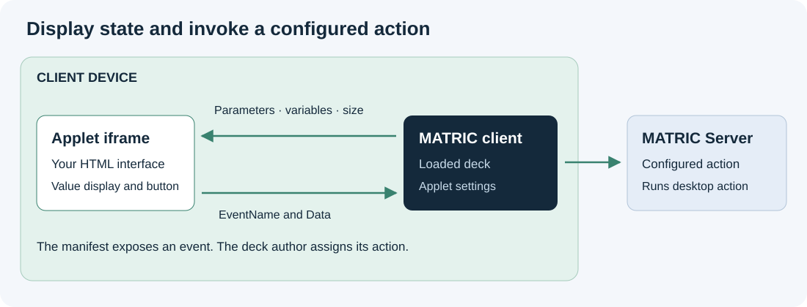

# Your first custom applet

Create a small HTML control that shows a server variable and sends text through a configured MATRIC action. It uses two files and no build tools.

For a complete copyable design, use the [starter applet](starter.md). Read [Size and lay out an applet](layout.md) before customizing it. It includes fitting patterns used by bundled applets and the sizing pitfalls to check on a real client.

## Install the example

Create `hello-applet` in the Windows Documents folder used by MATRIC, then copy the example's [manifest.json](../examples/applets/hello-applet/manifest.json) and [applet.html](../examples/applets/hello-applet/applet.html) into it:

```text
Documents/
└── MATRIC/
    └── custom/
        └── hello-applet/
            ├── manifest.json
            └── applet.html
```

Use the actual Documents known folder, which may be redirected to OneDrive. The manifest's `AppletId` must match the folder name.

## Add it to a deck

1. Add a **Custom applet container** in the editor and give it enough space for a button and a value.
2. In control properties, refresh the applet catalog if necessary, then select **Hello applet** under **Custom applet**.
3. Set **Variable to display** to an existing variable, or type `hobby_temperature` to use the UDP example.
4. Enable **Allow user interaction with embedded applet**.
5. In **Events and actions**, bind **Activate** to **Text** and set the text to `Hello from my applet!`.
6. Save and open the deck on a connected client. On the PC, focus a blank text editor, then tap **Send text** on the client.

You should see the configured text typed into the focused application. The applet displays `23.5` if the UDP example has published `hobby_temperature`; otherwise it displays **Waiting for value**. The editor preview displays variables but disables interaction. Test taps and desktop effects on the client.

## How it works



`manifest.json` declares the parameter and event shown in the editor:

```json
{
  "AppletId": "hello-applet",
  "DisplayName": "Hello applet",
  "VersionMajor": 1,
  "VersionMinor": 0,
  "AppletParams": [
    { "Name": "VariableToDisplay", "DisplayName": "Variable to display",
      "ParamType": "variable", "Default": "hobby_temperature" }
  ],
  "EventsDefinition": [
    { "Name": "activate", "DisplayName": "Activate",
      "AllowedActions": ["ActionText"] }
  ]
}
```

The parameter contains a variable **name**. The applet looks up that name in the latest variable snapshot. It sends `activate` with `Data: null` because the Text action uses the text saved in the deck.

The HTML example registers its message listener before requesting state. It retains parameters and variables separately, handles either arrival order, checks the sender and preserves `0` and `false`. Copy those patterns when building your own control.

## Edit and reload

Edit the installed files, then choose **Reload applet** in control properties. Reopen the deck on the client if it still shows old content. Ordinary resizing and parameter changes do not reload the iframe, so respond to updates in your code.

Keep `AppletId` stable for compatible updates. Selecting a different applet resets the container's parameters and event actions. Continue with the [applet reference](reference.md) for more parameter types, event data and packaging.

Before designing a larger interface, read [Size and lay out an applet](layout.md). Container proportions and pixel dimensions depend on the deck layout; HTML is not automatically scaled to fit.
