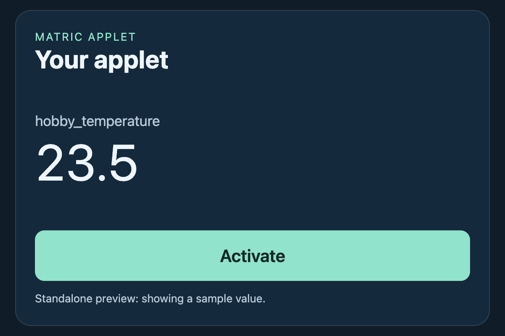

# Copy and customize the starter applet

Start with a complete applet that already handles proportional sizing, parameters, server variables and a configured action. It uses the fitting pattern from MATRIC's included clock and counter applets, with no dependencies or build step.



## Download and install

Download [starter-applet.mapl](../examples/applets/starter-applet.mapl) and double-click it on the Windows PC running MATRIC. Alternatively, copy the source files into your actual Documents folder, including when Documents is redirected to OneDrive:

```text
Documents/MATRIC/custom/starter-applet/
├── manifest.json
├── applet.html
├── applet.css
├── applet.js
└── README.md
```

Source downloads: [manifest](../examples/applets/starter-applet/manifest.json), [HTML](../examples/applets/starter-applet/applet.html), [CSS](../examples/applets/starter-applet/applet.css), [JavaScript](../examples/applets/starter-applet/applet.js), [README](../examples/applets/starter-applet/README.md).

Opening `applet.html` in an ordinary browser shows a standalone preview with a sample value. Its button explains that actions require installation in MATRIC; it does not simulate a successful desktop action.

## Try it in MATRIC

1. Add a **Custom applet container** to a test deck. Start with **6 × 4 cells**, matching the starter's 3:2 design.
2. Refresh the applet catalog if needed, select **Starter applet**, and enable **Allow user interaction with embedded applet**.
3. Choose an existing **Variable to display**. Use `hobby_temperature` with the [Python example](../udp/quickstart.md), or choose one of your own variables.
4. Bind **Activate** to **Text** in **Events and actions** and configure the text to type.
5. Save, load the deck on a client, focus a blank text editor on the PC, and tap **Activate**. The configured text should be typed there.

The editor displays values but disables the button. Missing or null values display **Waiting for value**; zero and false remain visible. Parameter and variable updates can arrive in either order. Neither ordinary resizing nor returning to the applet resets its data.

## Keep the fitting code

The starter defines one **600 × 400** design rectangle. It measures the available iframe viewport, subtracts an outer inset, takes the smaller width/height scale, and centers the whole design. It repeats the calculation when the viewport, padding or visibility lifecycle changes. The code comments identify the fitting and message-handling sections to keep when replacing the UI.

| Parameter | Behavior |
| --- | --- |
| Caption | Heading text |
| Variable to display | Name of the server variable to look up |
| Outer padding | CSS pixels around the scaled design; clamped to 0–256 and further limited to fit tiny viewports |
| Accent color | Button and heading accent |
| Background color | Color of the unused space around the design |

Matching the container to 3:2 uses the space efficiently. Other shapes keep the same proportions and leave unused space. No content is stretched or cropped to fill the rectangle.

For touch interaction, start at approximately **480 × 320 CSS pixels with the default 12px outer padding**. At that size the 64px design button remains over 44 CSS pixels high. Larger padding needs a larger container. Very small containers still fit, but the text and touch target shrink with the design. Test on your target device; fitting inside the rectangle does not guarantee usability.

## Make it yours

Copy the installed folder under a new name, then change `AppletId` in `manifest.json` to exactly that name. Update the display name, description, author and version. This keeps experiments separate from the original starter.

Edit `applet.html` and `applet.css` for your interface. Change `DESIGN_WIDTH` and `DESIGN_HEIGHT` in `applet.js` if you need different proportions; those constants size both the element and the fitting calculation. Adjust the internal layout to suit the new dimensions. Keep a single overall scale and the root height/margin reset.

Long headings and values are shortened visually with an ellipsis, with the complete text retained in `title`. Choose wrapping or another layout if your content needs every character visible. For draggable custom graphics, convert pointer coordinates using the transformed element's `getBoundingClientRect()`.

The example exposes only the **Text** action, which needs no held-input release. If you add hotkey or vJoy holds, implement the [paired release and cancellation handling](reference.md#release-held-input) too.

Use **Reload applet** after edits, and reopen the client deck if content is stale. See [Size and lay out an applet](layout.md) for alternative layout strategies and the [applet reference](reference.md) for additional parameter and event types.

## Share your version

Zip the contents of your renamed folder and rename the archive to `.mapl`. Keep `manifest.json` and `applet.html` beside each other at the archive root. Share that package alongside any `.deck` that uses it; applet files are not included in a deck export. Importing the same applet ID replaces the installed folder, so keep a backup before updates.
