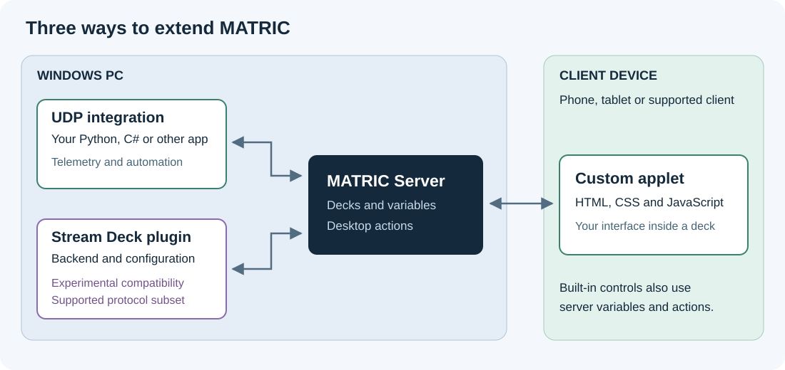

# Extend MATRIC

Build a small integration, add your own control to a deck, or reuse a supported Stream Deck plugin. You can start with Python or browser JavaScript; you do not need to build MATRIC from source.

## Choose an extension path

| You want to… | Start with | Your code runs in |
| --- | --- | --- |
| Show game telemetry, update controls, or react to deck interactions from another program | [UDP Integration API](udp/quickstart.md) | A separate process on the MATRIC Windows PC |
| Create a gauge, dashboard, keypad, or other custom interface inside a deck | [Custom applets](applets/quickstart.md) | An HTML iframe on each client displaying the applet |
| Use an existing plugin action, or write a plugin using the Stream Deck protocol | [Stream Deck compatibility](stream-deck/guide.md) | A backend on the Windows PC, with an optional configuration window |

**Stream Deck support is experimental.** Compatibility depends on the plugin, version, action and external software it uses. The [combined encoder applet](stream-deck/encoder-applet.md) adds compatible display feedback and tap/hold to rotary input. Profile switching, Stream Deck deep links, Elgato action/profile import and export, continuous sliders, custom encoder layouts and special hardware displays remain excluded.

These paths can work together. For example, a Python integration publishes a temperature as a server variable, and an applet draws it as a gauge. Try the [live status recipe](recipes/live-status.md) after your first example.

**Building an applet?** [Copy the starter applet](applets/starter.md), then read [Size and lay out an applet](applets/layout.md) before changing its interface. MATRIC sizes the iframe; your applet must handle its contents, proportions and readable controls.

## Understand the building blocks

A **server** is the MATRIC Windows application that stores decks and executes desktop actions. A **client** is a connected phone, tablet or supported client application. A **deck** contains pages; each page contains controls. An **action** is work assigned to a control event, such as a press or a value change.

**Server variables** let integrations and built-in features publish named values. Controls can bind properties to them, and applets receive their current values. Use a prefix you own, such as `hobby_temperature`, to avoid collisions.

Names and IDs serve different purposes. A control's **Name** is a developer-assigned label such as `Status`; it is separate from its visible text. Its **Id** identifies that particular control. Copy IDs from the editor's control, page or deck properties. Get client IDs through the UDP API.

## Follow a short learning path

1. Choose one of the three quickstarts and use a disposable deck.
2. Run the supplied example and check the expected result.
3. Read that path's reference when you need more than the example.
4. Follow [sharing and troubleshooting](troubleshooting.md) before distributing your work.

## Keep execution and persistence separate

| Change | Where it lives |
| --- | --- |
| UDP button appearance or control state | Current client runtime; does not rewrite the saved deck |
| Applet parameter and action binding | Saved deck configuration |
| Applet JavaScript variables | That iframe's memory, unless the applet implements persistence |
| Stream Deck action settings | Saved action occurrence in the deck; API writes persist immediately |
| Stream Deck global settings | Shared plugin settings on that MATRIC server |

Install applets and plugins only from authors you trust. An applet is browser code; a plugin backend can execute native code on the PC. An applet event invokes actions the deck author has explicitly assigned to it.

## Public integration examples

See [MATRICIntegrationDemo](https://github.com/tgudelj/MATRICIntegrationDemo) for complete raw UDP and C# SDK applications, a demo deck and Windows build instructions.

[DCS-BIOS-MATRIC-Middleware](https://github.com/tgudelj/DCS-BIOS-MATRIC-Middleware) is a real-world, two-way integration between DCS World and MATRIC: cockpit indicators update deck displays, and deck controls send commands to DCS-BIOS. It requires a configured DCS-BIOS setup; see that project for installation and connection instructions.
