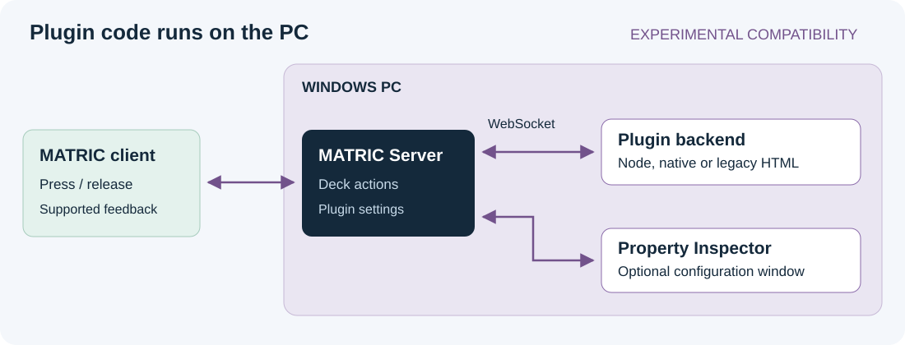

# Stream Deck plugin compatibility

**Experimental:** MATRIC hosts a supported subset of the Stream Deck plugin protocol. Use it to reuse plugin actions or build a plugin backend for desktop work. Test each plugin version and action with your target clients and external applications.

For a custom interface drawn inside a deck, start with an [applet](../applets/quickstart.md). A Stream Deck plugin instead receives logical control events and can send supported appearance updates back through MATRIC.



## Import an existing plugin

1. Use a complete MATRIC Desktop installation and a matching supported client. Have the plugin's complete, unpacked **`.sdPlugin` folder** ready.
2. Open **Settings > Stream Deck plugins**, or **Manage Stream Deck plugins** from a control's plugin action.
3. Set **Import source** to the parent folder containing the `.sdPlugin` folders. The default Elgato location is `%APPDATA%\Elgato\StreamDeck\Plugins`.
4. Select a package and choose **Import selected plugin**. MATRIC makes a managed copy in `Documents\MATRIC\sdplugins`. Importing does not start its backend or change the original installation.
5. On a test control's press event, add **Stream Deck plugin container**, then select **Choose plugin action**.
6. Choose **Configure** if the action has settings. MATRIC may automatically save the **whole deck**, including other pending edits, and clear undo history before opening the configuration window.
7. Configure the plugin's target application, close the window, load the saved deck on a client and test the control.

Starting with MATRIC Desktop **2.9.19**, you can instead choose **Import package…** in the plugin manager and select a `.streamDeckPlugin` ZIP package. In Windows Explorer, right-click the package and choose **Import plugin into MATRIC**; on Windows 11 this conventional command is under **Show more options**. The installer adds this command without changing the existing double-click association. Both routes use the same package validation and managed-copy import, leave the configured import source unchanged, and do not start the backend. If MATRIC is already running, the request goes to that instance; otherwise it starts MATRIC.

An archive must contain exactly one top-level `.sdPlugin` folder with its complete manifest and resources. Extraction rejects traversal, links, duplicate paths, more than 50,000 entries, nesting deeper than 64 components, individual files larger than 256 MiB, and total extracted content larger than 1 GiB. Stop an installed plugin before replacing it; package imports ask before replacing the managed copy and retain saved settings. Invalid archives leave the installed copy unchanged.

Protected packages cannot be used; an unreadable manifest may also be malformed or damaged. Obtain a complete package you are allowed to run and redistribute.

### Install from the OpenAction marketplace

Choose **OpenAction marketplace** in MATRIC's plugin manager to browse the [Tacto OpenAction marketplace](https://marketplace.tacto.live/) in your default browser, then click **Install** on a plugin page. This button is available in Settings and the separate management window; it does not change the folder import source or install a plugin by itself. MATRIC Desktop 2.9.19's installer registers MATRIC as an alternative handler for marketplace install links. Windows uses the selected handler for `opendeck:` links; if necessary, choose **MATRIC** in Windows **Settings > Apps > Default apps** for the OPENDECK link type. An existing OpenDeck default is preserved. Windows may ask for an initial default choice, and the browser may ask permission to open the desktop application. MATRIC does not display a host-selection prompt or forward the link to OpenDeck.

The accepted link is `opendeck://installPlugin/<plugin-id>`, for example `opendeck://installPlugin/me.amankhanna.oacounter`. Other operations, extra paths, query parameters and fragments are rejected. This installs a package only: Stream Deck account callbacks, plugin deep-link messaging and profile switching remain unsupported.

If clicking **Install** does nothing on the original 2.9.19 installer, select MATRIC for OPENDECK links in Windows Default apps, then try again. That installer advertises an alternative without providing a launch command when no host is already assigned. The installer correction supplies a fallback only for an unclaimed scheme, preserves another host's command and Windows user choice, updates an owned command on upgrade and removes only its own command on uninstall. Failed setup transactions restore the previous command. These registration details do not expand the accepted install-link format or plugin compatibility.

MATRIC looks up the exact ID in the [OpenAction plugin catalogue](https://openactionapi.github.io/plugins/catalogue.json). It uses the listed GitHub package download, or resolves the repository's latest stable GitHub release. It accepts `.zip` and `.streamDeckPlugin` assets, prefers a Windows x64 build, excludes assets explicitly named for Linux, macOS or ARM, and stops if the best choice is ambiguous. In that case, download the appropriate package yourself and use the package or folder import workflow above. Catalogue inclusion does not establish Windows or MATRIC compatibility; device-provider plugins and Linux actions remain excluded.

Downloads use HTTPS with restricted GitHub redirect hosts, a three-minute deadline and a 256 MiB limit. Release SHA-256 metadata is verified when provided. The archive must contain exactly one top-level `.sdPlugin` folder, and its plugin identity must match the requested catalogue ID before any managed copy can be replaced. The ordinary compatibility, archive safety and active-backend checks still apply. Imports leave the backend stopped; updates retain the existing replacement confirmation and require stopping that plugin first. Temporary downloads are removed after the operation. Network failures or GitHub rate limits can prevent an import; retry later or use a manually downloaded package.

## Windows OpenAction plugins

MATRIC Desktop 2.9.19 also hosts Windows **[OpenAction](https://openaction.amankhanna.me/) action plugins**, using the same plugin manager and experimental compatibility boundary. Linux actions and device-provider plugins are excluded. An OpenAction package must provide a Windows x64 entry point; packages for another operating system alone cannot run. Extract ordinary `.zip` distributions into their complete `.sdPlugin` folders before using the folder import workflow. A `.streamDeckPlugin` archive uses the package workflow above.

OpenAction manifests may omit Elgato's `SDKVersion` and derive their plugin identity from the `.sdPlugin` folder. An explicitly declared SDK version must still be supported. `CodePaths["x86_64-pc-windows-msvc"]` takes precedence over `CodePathWin` and `CodePath`. The Windows OS minimum is optional; `MinimumVersion`, or OpenAction's `Version` when it is absent, is enforced when supplied. Plugin versions may include Semantic Versioning prerelease and build identifiers, with a maximum length of 128 characters.

For extensionless OpenAction icons, MATRIC resolves `.svg`, `@2x.png`, then `.png`. A state's omitted image or `actionDefaultImage` uses the action icon. Large static package images up to 4 MiB and 2048 × 2048 pixels are reduced to at most 256 × 256 when needed to fit the 512 KiB prepared-image limit. Data URLs, SVGs and animated images retain the 512 KiB limit; self-contained SVG restrictions still apply. Normal images are preserved. Missing state titles default to empty text and the default title size is 16 pixels. Rich font styling and title-parameter change notifications are not fully reproduced.

Both `connectOpenActionSocket` and `connectElgatoStreamDeckSocket` bootstrap functions are accepted, including global lexical declarations. Native Windows backends use the existing port/registration arguments; a Rust toolchain is not needed on the user's PC. For OpenAction packages, per-action and global settings can contain any JSON value, including arrays, scalars and null. Object settings continue to work for existing Stream Deck/Mirabox plugins. Two-state OpenAction actions toggle automatically on key release unless `DisableAutomaticStates` is set.

### Inspector startup compatibility

Prefer a documented `connectOpenActionSocket` or `connectElgatoStreamDeckSocket` function. MATRIC waits for functions defined asynchronously and calls one function once with the existing startup arguments. This path also supports inspectors that open their own configuration popup before registering.

For OpenDeck inspectors that expose neither function, MATRIC waits through the normal startup period (15 seconds by default), then sends one browser message to the validated inspector document's own origin:

```javascript
{ event: 'connect', payload: [port, inspectorUUID, registerEvent, info, actionInfo] }
```

In this fallback, `port` is a number and `info` and `actionInfo` are parsed objects. The named-function path retains its string arguments. The fallback is an OpenDeck compatibility convention, not an additional OpenAction WebSocket event. MATRIC allows five seconds for the inspector to register after the message, then revokes a failed session. It does not retry the message, invoke a later function after choosing this path, or send the startup message to other frames. Closing the window cancels pending startup. Both paths retain normal session authentication and browser isolation.

### Plugin-wide settings windows

When a native or Node backend declares `HasSettingsInterface: true`, the plugin manager offers **Plugin settings**. MATRIC starts the backend if needed, waits for registration and sends `{ "event": "showSettingsInterface" }`. This is independent of a saved control occurrence and does not create a Property Inspector or automatically save a deck. The backend is responsible for creating or bringing forward its own window; there is no acknowledgement proving that it opened. MATRIC reports that it requested the window. Closing the plugin's window does not stop its backend; **Stop backend** stops the owned process tree. HTML backend popups are unsupported and do not get this button.

Device-provider messages such as `registerDevice`, `deregisterDevice`, hardware input injection and `rerenderImages` are rejected as unsupported capabilities. They never register a device or inject input into MATRIC. Profile switching, deep links and continuous sliders remain excluded. Compatible encoder display and touch input are available through the [combined encoder applet](encoder-applet.md); custom layouts and special hardware displays remain excluded. A plugin may import successfully yet depend on an unsupported feature.

### Checked Windows examples

On 13 November 2026, isolated Windows checks with MATRIC 2.9.19 ran the unchanged [Counter 1.0.1 release](https://github.com/OpenActionPlugins/counter/releases/tag/v1.0.1) and [System Information 1.0.0 release](https://github.com/OpenActionPlugins/system/releases/tag/v1.0.0). Counter passed keypad press/release, relative encoder increments, independent occurrence settings, saved-deck persistence, backend restart and icon publication. Its unchanged Property Inspector opened in MATRIC's native CEF configuration window; changing the step value persisted across a separate-process restart. System Information published live CPU, RAM, uptime and OS labels. The tests preserved the original source package files.

Neither example declares a plugin-wide settings window. The `showSettingsInterface` request and manager button were checked with a controlled backend; an actual third-party plugin-owned GUI was not interactively verified. These results do not certify other plugin versions, phone/tablet display or unsupported features.

Additional unchanged packages were checked: TikClock 1.1.0, Clocks 0.9.5, Rotary Generic Command 1.1.0, Windows Essentials 0.16.3, Discord 0.5.1, CommandSender 1.5, Web Requests 0.1.1 and Dice 1.0.4. All ten packages passed import, backend registration, native inspector checks where provided, and source-preservation checks. Edited inspector settings survived a separate-process restart. CommandSender passed a full ten-state cycle using real loopback UDP and TCP commands with matching images; Web Requests passed HTTP body/header delivery, error feedback and Unicode WebSocket delivery; Dice passed deterministic rolls, independent occurrences and persistence. See [the validation record](https://github.com/tgudelj/MATRICDeveloperDocs/blob/main/VALIDATION.md#windows-plugin-regression-checks-for-matric-2919) for the tested scope and limitations.


## Build a minimal plugin

The Hello plugin example counts presses and changes the control's title. It needs no npm packages or external service. It declares **Node 24** and uses that runtime's built-in WebSocket client; do not change the manifest to Node 20 without providing a WebSocket implementation.

Download its [manifest.json](../examples/stream-deck/com.example.matrichello.sdPlugin/manifest.json), [plugin.mjs](../examples/stream-deck/com.example.matrichello.sdPlugin/plugin.mjs) and [icon.svg](../examples/stream-deck/com.example.matrichello.sdPlugin/icon.svg).

Copy the complete folder to a development directory on the MATRIC PC:

```text
my-plugins/
└── com.example.matrichello.sdPlugin/
    ├── manifest.json
    ├── plugin.mjs
    └── icon.svg
```

Choose `my-plugins` as the import source, import **Hello plugin**, and assign its **Count presses** action to a button's press event. Save the deck and load it on a client. Each press should display `Count 1`, `Count 2`, and so on. Counts are temporary and reset on each `willAppear`, including when MATRIC refreshes actions after Windows wakes. This action has no Property Inspector, so no configuration window is required.

The backend reads the port, registration event and registration identifier from its launch arguments. It registers with MATRIC, creates state on `willAppear`, handles `keyDown`, and removes state on `willDisappear`. A `setTitle` response uses the event's **context**, never a hard-coded control ID. Registration and event shapes follow the [Elgato WebSocket protocol](https://docs.elgato.com/streamdeck/sdk/references/websocket/plugin/).

```javascript
send({ event: 'setTitle', context: message.context,
  payload: { title: 'Count ' + count, target: 0 } });
```

The manifest identifies the package, backend and actions; see the [Elgato manifest reference](https://docs.elgato.com/streamdeck/sdk/references/manifest/). MATRIC's support limits below still apply when a manifest or SDK exposes more features.

## Know the compatibility boundary

| Area | MATRIC behavior |
| --- | --- |
| Package backends | Windows native `.exe`, JavaScript and legacy HTML entry points; native dependencies remain package-specific |
| Declared Node runtime | 20 or 24; legacy/unspecified JavaScript uses Node 20 |
| Manifest SDK versions | 1–3 accepted by package validation; acceptance does not certify every SDK feature |
| Keypad input | Discrete press/release; rotary controls can produce button-style click pairs in Keypad mode |
| Encoder input | Relative signed rotation ticks and center down/up; the combined applet adds tap/hold on the same instance; legacy `Knob` maps to Encoder in MATRIC while retaining its wire name |
| Encoder display | Combined applet: complete images and six built-in layouts; keyed partial feedback and aspect-preserving image fitting |
| Keypad appearance | Per-state title/image and plugin-selected states, including more than two; OK/alert feedback; runtime only |
| Settings and messaging | Per-action/global settings and backend–Property Inspector messaging |
| Resource API | Explicit deck-owned file snapshots through `getResources`/`setResources` |
| Application and wake events | Server application monitoring and Windows wake notifications |
| Excluded | Profile switching, Stream Deck deep linking, Elgato `.streamDeckAction`/`.streamDeckProfile` import/export, continuous sliders, custom encoder layouts, swipe navigation and special hardware displays |

Ordinary rotary controls provide input; use **Plugin touch strip + rotary** for one action instance combining its display, touch input and rotary. See the [encoder applet guide](encoder-applet.md) for installation, properties, payloads, logical devices, lifecycle and validation limits. Stream Deck Multi Action behavior is not fully reproduced. Account flows that require Stream Deck deep-link callbacks are unsupported. `openUrl` accepts absolute HTTP/HTTPS URLs only.

Legacy packages that omit a plugin UUID may use mixed-case action IDs; MATRIC preserves their exact wire identities and still checks action collisions case-insensitively. A single leading `/` in a legacy manifest image denotes the package root, with normal path confinement checks. Explicit-UUID packages retain the existing action identifier and ownership validation. These allowances do not certify every Stream Dock plugin.

A package status of **Ready** means it passed import validation. A registered backend means it connected to MATRIC. Neither proves that its external service works or that all actions are compatible.

MATRIC reads optional package translations for plugin names, categories, action names and tooltips. English is the fallback, followed by the configured registration language. Missing, malformed or oversized translation files retain the available fallback strings. Action identities and package files are unchanged. See the [SDK localization format](https://docs.elgato.com/streamdeck/sdk/guides/i18n/).

When selecting a new action, MATRIC copies an optional action-level manifest `Settings` value into that occurrence. This supports vendor defaults such as a capture/playback device selector. Each occurrence owns a separate copy. Existing settings and plugin writes are not merged with defaults or silently rewritten; selecting another action resets the occurrence and applies that action's defaults.

## Plugin modes and physical input

A Keypad action's state is a plugin-owned visual or operating mode. It is independent of whether the MATRIC control is physically pressed, released or toggled. `keyDown` and `keyUp` retain their input meaning, and `payload.state` reports the current plugin mode. Selecting a mode does not synthesize input, change the control's stored state, or change its saved design.

For an action declaring `N` manifest states, `setState` accepts integer indices `0` through `N - 1`. An action with no declared states has an implicit state zero. Negative, fractional, string, null and out-of-range values are rejected without changing the current mode. Actions with more than two states select their modes explicitly through the plugin; MATRIC does not automatically cycle them. Existing two-state automatic toggling remains: on press for Stream Deck packages and on release for OpenAction packages, unless `DisableAutomaticStates` is true.

```javascript
// Select the fourth declared state and customize its runtime appearance.
send({ event: 'setState', context, payload: { state: 3 } });
send({ event: 'setTitle', context, payload: { state: 3, title: 'Mode 4' } });
send({ event: 'setImage', context,
  payload: { state: 3, image: 'images/mode-4.png' } });
```

Each state retains its own manifest image, title and supported formatting. Supplying a `state` with `setTitle` or `setImage` targets that state; omitting it or supplying null updates every declared state. Resetting an image restores that state's manifest image. Appearance recovery snapshots retain the selected mode. Backend restarts create fresh contexts at state zero; plugins can restore a different mode from their own saved settings.

Runtime feedback uses the existing prepared-image cache and sends the currently selected image to clients. It does not require writing images into a deck's additional resources. Shared limits remain: 4,096 visual contexts, 8,192 cached state slots in total, 64 MiB of prepared images, and an image-work queue of 8,192 entries or 8 MiB of queued source data. Exceeding visual capacity can suppress feedback while input remains available. Existing per-image validation and byte limits also apply.

## Settings and files

A Property Inspector is the plugin's configuration UI. Keep durable settings in the protocol's settings API; its private browser storage is temporary.

Action settings belong to a **saved action occurrence**, not merely an action UUID. Global settings are shared by that plugin across the MATRIC server. Plugin API writes persist immediately; closing the inspector, Undo and deck Discard do not roll them back. Configure requires a saved binding.

For files that should travel with a deck, use `setResources` with a complete key-to-absolute-file-path map. MATRIC snapshots those files into the deck; `getResources` and event payloads return resolved server-local paths. Replacing the map with `{}` clears its references. Merely storing a path in settings does not capture the file.

MATRIC copying, Save As and `.deck` export preserve referenced managed resources with independent identities. Plugin binaries, global settings and external application installations are not included. Install matching dependencies on the receiving PC and configure credentials there.

## Lifecycle and multiple devices

Devices loading the same saved deck share its plugin action occurrences, settings and feedback. Plugin events represent the shared deck actions rather than a separate physical Stream Deck screen for every tablet. Page changes do not send ordinary plugin `willDisappear`; contexts stay active while at least one device has the deck loaded. Do not use `willAppear` as proof a particular page is visible.

Avoid overlapping holds of the same action from two devices: releasing on one can end the other's effect. If multiple bindings write a control's appearance, the most recent applicable write wins. Use separate controls or deck copies when independent state matters.

## Develop and troubleshoot

Edit your source package, stop its backend in MATRIC, then import it again with **Replace installed copy**. Managed copies do not update automatically. Close Elgato Stream Deck or StreamDock if the plugin cannot run in two applications at once.

Use the management screen's backend state and messages, then [the troubleshooting guide](../troubleshooting.md). Test settings through restart, action behavior on a real client, external-service recovery and sharing on another PC. Verify the specific plugin and actions you plan to distribute.
