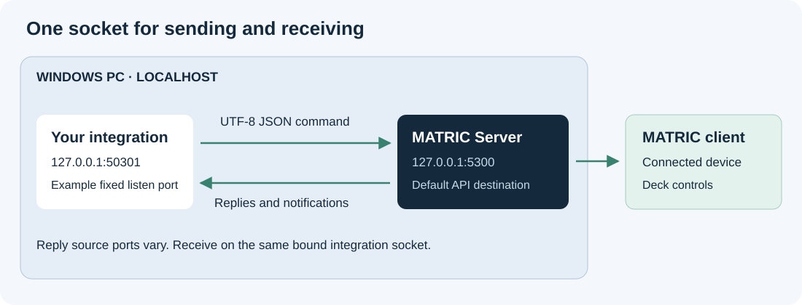

# Your first UDP integration

Use Python to find a connected MATRIC device, change a button label and publish a variable. The [complete example](../examples/udp/status.py) uses only Python's standard library.

## Prepare MATRIC

1. Run MATRIC Server on Windows and connect a supported client.
2. In Settings, enable **Enable 3rd party integration**. If **Require integration PIN** is enabled, leave it enabled and authorize your example when prompted.
3. Check **Integration API port** in advanced network configuration. The default is **5300**. Save settings; restart MATRIC after changing network ports.
4. In a test deck, add a button and set its **Name** to `Status` in control properties. Save the deck and load it on your client.

The API listens on **127.0.0.1**, not the PC's LAN address. Run this example on the Windows PC running MATRIC. A program on another machine needs a local companion process that talks to this API.



## Run the example

Install Python 3 on that PC and copy `status.py` there. From its folder, run:

```powershell
py status.py
```

The program first sends `CONNECT`. If MATRIC asks you to authorize **Hobby status demo**, approve it and enter the displayed PIN into the terminal. Keep leading zeroes. With PIN checking disabled, press Enter at the terminal prompt.

The example prints the connected clients, selects the first one, sets the `Status` button label to **Hello from Python**, then publishes `hobby_temperature = 23.5`. It keeps listening and prints control interactions and variable updates until you press Ctrl+C.

To choose a client or use different ports:

```powershell
py status.py --client-id YOUR_CLIENT_ID --port 5300 --listen-port 50301
```

Use the client ID from the printed list. `--port` is MATRIC's receiving port; `--listen-port` is your program's port. Keep your listen port stable across restarts and give separate integrations distinct application names and listen ports.

## Understand the command

The button update is one UTF-8 JSON object in one UDP datagram:

```json
{
  "command": "SETBUTTONPROPS",
  "appName": "Hobby status demo",
  "appPIN": "YOUR_PIN",
  "clientId": "YOUR_CLIENT_ID",
  "buttonName": "Status",
  "data": { "text": "Hello from Python" }
}
```

This changes the running client display. It does not edit the saved deck or trigger the button's actions. Reloading the deck can restore its saved appearance.

Replies contain JSON inside a string:

```python
envelope = json.loads(datagram.decode("utf-8"))
payload = json.loads(envelope["MessageData"])
```

Read the [UDP reference](reference.md) for commands, state objects and event payloads. Continue with the [live status recipe](../recipes/live-status.md) to display your variable in an applet.

## More integration examples

For complete Windows C# applications, see [MATRICIntegrationDemo](https://github.com/tgudelj/MATRICIntegrationDemo). It includes raw UDP and C# SDK examples, a demo deck and build instructions.

For a real-world example, see [DCS-BIOS-MATRIC-Middleware](https://github.com/tgudelj/DCS-BIOS-MATRIC-Middleware). It connects DCS World cockpit data and controls to MATRIC and includes its own setup guide.
